<div align="center">

[English](README.md) · **한국어**

# self-clone

### "이거 너라면 어떻게 해?" 하고 물어보세요.<br/>트리 하나만 보고, 당신처럼 답합니다.

**몇 년 동안 쌓인 세션·셸 기록·티켓·스레드를 지식 트리 하나로 압축했어요.<br/>Claude는 그 트리만 읽고도 당신 방식 그대로 일합니다.**

[](#설치)
[](https://agentskills.io)
[](#요구-사항)
[](#절대-하지-않는-것)
[](LICENSE)

[그냥 물어보세요](#그냥-물어보세요) · [빠른 시작](#빠른-시작) · [노드 안에는](#노드-안에는-이런-게-들어-있어요) · [시험](#시험은-같은-질문에-점수를-매기는-것) · [동작](#동작) · [FAQ](#faq)

<code>/plugin marketplace add LazyerIJ/self-clone</code>

<br /><br />



</div>

---

## 왜 만들었나

일하는 레포마다 코드를 아는 Claude 하네스(`CLAUDE.md`, 스킬, 문서)는 이미 있어요. 그런데 **당신**을 아는 하네스는 없죠. 일이 어디서 들어오는지, 그 일에 어느 레포를 여는지, 손으로 직접 치는 명령이 뭔지, 누구한테 물어보는지, 하네스가 멈춰서 당신을 기다릴 때 뭘 보고 결정하는지 같은 것들이요.

이 지식은 사실 이미 다 있어요. 몇 년 치 Claude 세션, 셸 기록, 노트, git 로그, 티켓, 채팅 스레드에 흩어져 있을 뿐이에요. 다만 질문할 때마다 그걸 전부 뒤질 수는 없잖아요.

그래서 self-clone은 그걸 한 번 소화해서 **깊고 좁은 트리**로 만들어요. 그다음부터는:

> 🧠 **Claude가 읽을 건 트리 하나뿐이에요.**
> 원본 로그를 다시 읽지도, 슬랙을 다시 뒤지지도 않아요. 어떤 일에 대해 물어보면 *당신이* 처리했을 방식 그대로 답이 나와요. 같은 명령, 같은 사람, 같은 판단으로요.

"믿어 봐, 너 잘 알아"로는 부족하니까, 트리는 당신이 실제로 한 일과 계속 대조해서 시험을 봐요. 틀린 곳은 다시 트리에 꽂혀서 다음에 자라요.

## 그냥 물어보세요

트리가 다 자라면 이렇게 써요. [`examples/acme`](examples/acme)의 가상 엔지니어 Alex로 예를 들면:

> **나:** v2.14 이후로 PDF 인보이스 내보내기에서 합계 줄이 빠졌어. 너라면 어떻게 해?

> **클론** *(`tree/`만 읽음)*:
> v2.13에서는 됐으니 회귀 버그고, 내보내기가 완전히 죽은 건 아니라 핫픽스까진 아니에요. 바이섹트로 찾을게요.
>
> 1. `~/code/acme-api`에서, 작업 트리가 지저분하면 먼저 `git stash -u`.
> 2. `git bisect start main v2.13 && git bisect run make test-fast TEST=<인보이스 내보내기 테스트>`
> 3. **의존성 업데이트**에 걸리면 멈춰요. 직접 고치지 말고 sha를 **Priya**한테 넘겨요(의존성 담당). CSV 헤더가 사라졌던 ACME-412 때도 이렇게 했어요.
> 4. **마이그레이션**에 걸리면 로컬에서 다시 돌리지 말아요. `[harness: acme-api — <sha>가 스키마에서 뭘 바꿨나?]`
> 5. 티켓에 `first bad: <sha> (<author>), found by bisect` 코멘트를 남기고 `git bisect reset`.
>
> 📎 *출처* `work/bugs/regression/bisect/local-repro/first-bad-commit`

이 중에 코드에서 나온 건 하나도 없어요. 레포, 태그 범위, Priya, "마이그레이션은 건드리지 않는다"는 규칙, 티켓 코멘트까지 전부 Alex 자신의 기록에서 나와서 노드 하나에 정리된 거예요.

트리에 없는 건 `[not in tree]`, 확신이 없는 건 `[guess]`라고 솔직하게 말해요. 아는 척하지 않아요.

## 빠른 시작

```
/plugin marketplace add LazyerIJ/self-clone
/plugin install self-clone@self-clone
/clone-init
```

`/clone-init`이 다섯 가지(홈 폴더, 이름, 레포 위치, 노트 폴더, 절대 읽지 말아야 할 폴더)만 물어보고 **클론 홈**을 만들어 줘요. 원격 없는 로컬 git 폴더예요. 그다음:

```
cd ~/self-clone-home && claude
/survey          # 원천 지도 그리기: 레포·세션·셸, 그리고 닿는 이슈 트래커·채팅·위키
/loop /grow      # 한 번에 노드 하나씩 계속 키워요. grow 10번마다 /exam이 알아서 끼어들어요
```

특정 건을 가르치고 싶으면 `/grow ACME-412`나 `/grow <채팅 스레드 링크>`. 그 건을 처음부터 끝까지 따라가서 걸리는 노드마다 꽂아 줘요.

충분히 자랐다 싶으면 클론 홈에서 Claude를 열고 그냥 물어보면 돼요.

## 노드 안에는 이런 게 들어 있어요

위 답변이 나온 settled 노드예요([전체 파일](examples/acme/tree/work/bugs/regression/bisect/local-repro/first-bad-commit/_branch.md)).

```markdown
## Run
- where: `~/code/acme-api`, clean tree (`git stash -u` first if dirty)
- what: `git bisect start main <last-good-tag> && git bisect run make test-fast TEST=<failing test>`
- judge: lands on a dependency bump → stop, go to `culprit-handoff` (Priya owns deps);
         lands on a migration → never re-run it locally, ask the acme-api harness what <sha> changes
- leave: comment on the ticket `first bad: <sha> (<author>), found by bisect`, then `git bisect reset`

## Cases
- ACME-412 (2026-08): CSV export lost the header row → bisect hit a pandas bump → handed to Priya → fixed same day
- ACME-431 (2026-09): `/orders` 30% slower → bisect hit Alex's own N+1 → asked the harness for a fix → merged next morning

## Exam
- Q: Bisect lands on a dependency bump. What now? A: Stop — hand it to Priya with the sha.
```

코드는 한 줄도 안 옮겨요. 노드에는 **뭐가 어디 있고, 언제 열고, 누구한테 묻고, 어떻게 판단하는지**만 담고, 레포 하네스가 이미 아는 건 그쪽을 가리키기만 해요.

### 팀이 쓰는 도구와도 같이 돼요

일이 Slack·Jira·GitLab·Confluence·Sentry를 오간다면 MCP 서버나 CLI로 연결만 해 두세요. `/survey`가 알아서 찾아요. 도구마다 이야기의 한 조각(스레드 속 요청, 티켓, MR, 알림)을 갖고 있는데, `/grow`가 한 건을 그 전부에 걸쳐 따라가요. 그렇게 트리는 *요청이 첫 메시지부터 마지막 회신까지 실제로 어떻게 흘러가는지*를 배워요. 읽기만 해요. 메시지, 코멘트, 상태 변경, 머지는 절대 안 해요.

이렇게 키운 실제 트리 하나는 `/loop /grow` 사흘 만에 **노드 약 750개, 실제 사례 약 430개, 시험 문항 약 1,100개**가 됐어요.

## 시험은 같은 질문에 점수를 매기는 것

"에이전트 메모리"는 대부분 아무도 검증하지 않아요. 여기선 시험이 곧 [그냥 물어보세요](#그냥-물어보세요)의 그 장면이에요. 다만 당신이 실제로 어떻게 했는지 이미 아는 지난 티켓으로 풀어요.

1. **실제 일 고르기.** 지난 티켓 재연(처음 들어온 요청만 보여 줘요), 문제 은행의 시나리오, 아니면 트리의 가장 약한 곳을 찌르는 새 질문.
2. **트리만 보고 답하기.** Explore 서브에이전트는 트리가 가리키는 경로만 열 수 있어요. 빠진 단계는 `[not in tree]`, 애매한 건 `[guess]`, 코드 질문은 `[harness: <레포> — <물을 말>]`로 넘겨요.
3. **실제로 한 일과 대조해 채점.** 정확·실행·판단·사람·완결, 축마다 0~5점. **22/25 이상에 `[not in tree]`·`[guess]`가 하나도 없으면** 그 일은 *당신을 대신할 수 있다*는 뜻이에요.
4. **구멍 꽂기.** 빈 곳은 그게 들어갈 노드의 `## Unknown`에 꽂히고, 그 노드는 다시 growing으로 내려가요. `/grow`는 시험 구멍부터 메워요.

[시험 기록 예시](examples/acme/exams/log/2026-10-02-1410-R-checkout-500.md): **14/25 → grow 4번 → 23/25.**

## 동작

| 스킬 | 하는 일 |
|---|---|
| `/clone-init` | 클론 홈을 만들어요: `tree/`·`tools/`·`sources/`·`exams/`·`RULES.md` |
| `/survey` | 로컬 원천과 닿는 외부 시스템을 지도로 그려요. 자격은 각 도구가 스스로 들고 있는 것만 써요 |
| `/grow` | 부를 때마다 **노드 하나**를 키워요. 원천을 끝까지 읽고, 한 층 내려 쪼개거나 바닥 시험을 채워요 |
| `/exam` | 위의 시험 루프 |

**모양은 코드가, 내용은 모델이.** `tools/tree.py`(파이썬 표준 라이브러리만)가 트리를 깊고 좁게 유지해요. 가지당 자식 ≤ 3, 자식 하나짜리 가지 금지, 본문 ≤ 40줄, 층마다 갈래 기준 하나. 다음에 뭘 키울지도 골라요: 모양 위반 → 시험 구멍 → 꽂힌 사례 → 바닥 미달 → stub → 모름 → 오래된 노드. 뭘 어디에 둘지는 Claude가 정해요.

**바닥 시험.** 끝 노드는 *한 가지 일*이고, *적힌 그대로 할 수 있고*(정확한 명령·경로·채널·판단 규칙, 또는 "`<레포>` 하네스에 <무엇을> 묻는다"), *틀린 게 없고*(적은 사실은 전부 열어서 확인), 충분히 깊고, `## Run`·포인터 달린 실제 `## Cases` 두 개·`## Exam` 문답 세 개가 있고 `## Unknown`이 비어야 `settled`가 돼요.

```
tree/
├── work/       뭘 하나          → bugs/regression/bisect/local-repro/first-bad-commit
├── practice/   어떻게 판단하나  → approvals/reviewer-choice/…
├── systems/    뭘 다루나        → 지도: 레포·하네스·문서·주인·알림
├── env/        어디서 뭘로      → devices/laptop/ssh/jump-host
└── org/        누구와           → colleagues/design/<사람>/review-request
```

## 절대 하지 않는 것

- 🔒 **비밀 읽기.** `.env*`·키·토큰은 막혀 있어요. 자격이 있다는 사실만 적어요
- ✋ **클론 홈 밖에 쓰기.** 원천 레포와 외부 시스템은 읽기 전용이에요. 커밋·코멘트·메시지·상태 변경 없음
- 🙈 **고객·개인 데이터 저장**, 채팅·티켓 본문을 그대로 인용하기
- 📎 **이미 적혀 있는 것 복제.** 코드·문서·위키는 포인터만 남겨요
- 🏠 **내 컴퓨터 밖으로 나가기.** 클론 홈엔 git 원격이 없고, 웹 검색도 막아서 사내 이름이 검색창에 들어갈 일이 없어요

## 설치

**Claude Code** (권장)
```
/plugin marketplace add LazyerIJ/self-clone
/plugin install self-clone@self-clone
```

**skills CLI**
```
npx skills add https://github.com/LazyerIJ/self-clone
```

**수동**: `skills/*`를 `~/.claude/skills/`에 복사하면 돼요.

스킬은 [Agent Skills](https://agentskills.io) `SKILL.md` 형식을 따라요. Claude Code에서 만들고 시험했어요. `/exam`은 Claude Code의 서브에이전트와 `/loop`를 쓰기 때문에 다른 에이전트에서는 조금 손봐야 할 수도 있어요.

## 요구 사항

Claude Code · Python 3.9+ (표준 라이브러리만) · git.

## 설정

- `tools/shape.json`: 모든 한도(깊이·가지 수·바닥 시험·재방문 주기·시험 빈도)와 절 제목 자체. `## What`을 `## 무엇`처럼 원하는 언어로 바꿔도 돼요.
- `clone.json`: 이름, 작업 루트, 하네스 산출물 폴더, 노트 폴더, 읽지 않을 폴더.
- `RULES.md`: 클론이 따르는 규칙이에요. 마음대로 고쳐 쓰세요.

## FAQ

**그냥 큰 `CLAUDE.md`나 메모리 파일 아니에요?**
아니에요. 메모리는 옆으로 쌓이기만 하고 아무도 검증하지 않아요. 이 트리는 깊게 내려가도록 강제되고(층마다 갈래 기준 하나, "끝"이라고 하기 전에 바닥 시험), 이미 적힌 건 옮기지 않고, 시험이 어디가 틀렸는지 계속 보여 줘요. 그래서 트리 하나만 보고도 답할 수 있는 거예요.

**뭔가 업로드되나요?**
평소 쓰는 Claude Code 세션 말고는 없어요. 클론 홈은 원격 없는 로컬 git 폴더고, 만들어지는 권한 설정이 웹 검색·`git push`·비밀 읽기를 막아요.

**쓸 만해지려면 얼마나 걸려요?**
첫 `/survey`에 grow 수십 번이면 쓸 만한 지도가 나와요. 진짜 기준은 지난 티켓을 재연했을 때 "대체 가능"이 뜨는 거고, 거기까지 얼마나 남았는지는 시험 기록이 솔직하게 알려 줘요.

**개발 말고 다른 일에도 쓸 수 있어요?**
네. 측면(work · practice · systems · env · org)은 웬만한 사무 직무엔 다 맞아요. `tree/`와 `RULES.md`에서 이름만 바꾸면 돼요.

## 라이선스

MIT
